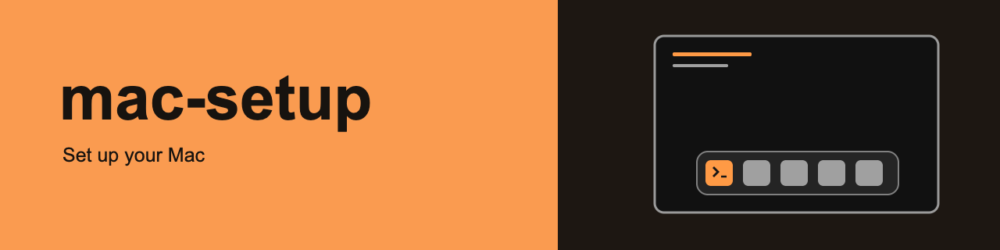

# mac-setup

mac-setup applies your settings and installs your chosen apps on a Mac.
You can also create accounts and give each account its own settings.

Your **profile** is a private folder of settings files.
You edit the profile, preview the changes, then apply them in Terminal.
mac-setup uses Ansible, a free tool that applies settings to a computer.
You do not need to know Ansible.
Nothing runs in the background.

## Before you start

Use an Apple Silicon Mac and sign in to an admin account.
The pinned downloads are arm64 builds.
Stay at the Mac's screen for the first run.

The example makes these main changes. Review both settings files before applying it.

1. The Dock moves left, uses icon size 32, holds only Terminal, and hides recent apps.
2. The desktop picture becomes solid black.
3. Finder uses list view and shows hidden files.
   Its sidebar starts with Applications, your home folder, Desktop, and Downloads.
   Recents, Shared, AirDrop, Trash, iCloud, and the home folder under Locations leave the sidebar.
4. Finder deletes Trash items after 30 days.
   To turn this off, change `finder.trash_auto_empty: true` to `finder.trash_auto_empty: false` in `accounts.yml` before running.
5. Dark mode uses an orange accent. The clock uses 24-hour time and shows seconds.
6. The firewall blocks all incoming connections, including SSH, with stealth mode on and no automatic app allowance.
   If you reach this Mac over SSH, remove `security.firewall_block_all` and `allow_lockout_risk: true` from `machine.yml` first.
7. Wi-Fi turns on. The display sleeps after 10 minutes, and the system sleeps after 30 minutes.
   You choose the time zone.
8. The example creates no extra account and installs no app.
   At the end, it opens Location Services and asks you to turn it off yourself.

mac-setup knows 1264 macOS settings. A run sets 569 of them, 41 need your click, and 654 it cannot set yet.
66 settings are proven on macOS 27.2.1.
A test applied each proven setting on a real Mac and read it back.
The other settings have unit tests, without real-Mac proof.
The [verification map](verify/features/README.md) describes the tests and their limits.

## Quick start

Open Terminal and run `xcode-select -p`.
If it prints an error, run `xcode-select --install`, click **Install**, and wait for installation to finish.
These Apple tools provide `git`.

### 1. Download mac-setup

```sh
git clone https://github.com/amrendra18/mac-setup.git ~/mac-setup
cd ~/mac-setup
```

Keep Terminal in `~/mac-setup` for the commands below.

### 2. Install its tools

```sh
scripts/bootstrap
```

The bootstrap needs no admin password.
It installs fixed versions and checks each download's SHA-256 fingerprint.
Look for `ansible-playbook [core 2.21.5]` at the end.
If a download fails, run `scripts/bootstrap` again.
See the [installation reference](docs/installation.md) for its files, hosts, and retry behavior.

### 3. Create or restore your private profile

Choose the folder before making a profile.
These instructions use `~/.dot/mac-setup/inventory/`, outside the downloaded project.
Every playbook command below selects it with `-i`.
The [profile guide](docs/profiles.md) also covers the default `.local/inventory/` location and migration.

If you already have a profile, restore it to `~/.dot/mac-setup/inventory/` instead of copying the example.
For an encrypted vault, restore its original password too, as [Secrets](#secrets) explains.

For a new profile, run:

```sh
test -d ~/.dot/mac-setup/inventory || { mkdir -p ~/.dot/mac-setup && cp -R inventory/example ~/.dot/mac-setup/inventory; }
```

An existing folder keeps its files. This local copy is not a backup.
Open both settings files in TextEdit:

```sh
open -e ~/.dot/mac-setup/inventory/host_vars/example-mac/accounts.yml
open -e ~/.dot/mac-setup/inventory/host_vars/example-mac/machine.yml
```

In `machine.yml`, replace `time.zone: GMT` with your zone, such as `time.zone: Europe/London`.
Run `readlink /etc/localtime` to see the current zone, the part after `zoneinfo/`.
Use a name listed by `systemsetup -listtimezones`. `Etc/UTC` is not accepted.
Review the other lines, including the Trash and firewall choices above.
See [Choose your settings](#choose-your-settings) before adding settings.

Apps are optional. Keep `apps.install: []` for a settings-only run.
To install apps now, complete [Apps](#apps) and [Secrets](#secrets) before previewing.
App previews download and check missing or older apps, so they need that setup too.

### 4. Preview the changes

```sh
.local/venv/bin/ansible-playbook -i ~/.dot/mac-setup/inventory playbooks/site.yml -K --check
```

At `BECOME password:`, type your Mac admin password and press Return.
A `changed` line means a setting would change.
The preview changes no Mac setting, creates no account, asks for no privacy permission, and opens no page.
It lists permissions and click-only pages.
It can download apps and build the sidebar helper inside `.local/`.

### 5. Apply at the Mac's screen

```sh
.local/venv/bin/ansible-playbook -i ~/.dot/mac-setup/inventory playbooks/site.yml -K
```

Type your admin password, then follow the prompts in order.

1. For the time zone, turn on **Terminal** in **Privacy & Security > Full Disk Access** when asked.
   Return to Terminal and press Return.
2. For the sidebar, click **Allow** for Desktop and Downloads access. Terminal keeps this folder access.
3. mac-setup applies the settings. If you listed a new account, type its password when asked.
   Typing stays hidden. mac-setup never stores that account password.
4. At the end, turn **Terminal** off in Full Disk Access when asked.
   Access that Terminal had before the run stays on.
5. Complete each click-only setting and press Return. The example asks you to turn Location Services off.

Full Disk Access lets commands in Terminal read every file.
If you stop with Control-C, turn Terminal off there yourself.
After a task fails, the run still asks you to remove access enabled during the run.
To remove folder access later, use **Privacy & Security > Files & Folders**.

Check the named Mac and summary for `skipped`, `refused`, logout, and other-account instructions.
`failed=0` means Ansible reports no failed task. Skipped changes can still remain.
Click-only settings depend on your actions. mac-setup does not verify those clicks.
After a complete apply, repeat the same command.
An unchanged, fully applied profile reports `changed=0`, meaning mac-setup applied no further managed changes.
Firefox can still update its own files when started for bookmark inspection.
Click-only pages open again. See [troubleshooting](docs/troubleshooting.md) if anything remains incomplete.

## Choose your settings

Inside `~/.dot/mac-setup/inventory/host_vars/example-mac/`, edit these files:

1. `accounts.yml` holds `default_settings` for your account and every listed account, plus the `accounts` list.
2. `machine.yml` holds `machine_settings` for the whole Mac. Those settings need admin rights.

For example, these complete sections show where each line belongs:

```yaml
default_settings:
  dock.position: bottom
accounts: []
```

```yaml
machine_settings:
  time.zone: Europe/London
  apps.install: []
```

In the copied files, edit lines under the existing sections. Keep the other settings you want.
Do not add a second `default_settings` or `machine_settings` section.
Use spaces for indentation. Quote the words `"on"`, `"off"`, `"yes"`, and `"no"`.
Without quotes, YAML, the settings file format, treats those words as true or false.
Removing a line stops mac-setup managing that setting and leaves its current value unchanged.

The template, [inventory/example/TEMPLATE.yml](inventory/example/TEMPLATE.yml), lists all 1264 settings in four sections.
They cover account settings, machine settings, click-only settings, and settings not yet supported.
The template gives allowed values and when supported changes appear.
For supported account and machine settings, copy the setting line into your profile and remove its leading `# `.
Use the listed scope to pick the section.
Put account settings under `default_settings` and machine settings under `machine_settings`.

A click-only entry lists its name without a colon or value. Add a colon and choose one of its listed values.
For example, `network.bluetooth_power` has machine scope and accepts `true` or `false`:

```yaml
machine_settings:
  network.bluetooth_power: false
```

Add the `network.bluetooth_power` line under the existing `machine_settings` section. Do not add another section.
The run guides you to turn Bluetooth off yourself.
Keep entries from "Not yet supported" out of your profile. The profile check refuses them.

### Dock apps, desktop and Finder sidebar

Add these lines under the existing `default_settings` section, replacing any lines with the same names:

```yaml
  dock.applications: [com.apple.Terminal, com.apple.Safari]
  desktop.wallpaper: black
  finder.sidebar_favorites: [/Applications, "~", ~/Desktop]
  finder.sidebar_favorites_only: true
  finder.sidebar_hide: [recents, airdrop]
```

1. `dock.applications` keeps only the listed app icons, in order. Folders in the Dock stay.
   Each bundle id is an app's unique name. Find Safari's with `osascript -e 'id of app "Safari"'`.
   Apps install before the Dock list applies, so a newly installed app can appear in the same run.
   Every listed app must exist when the Dock step runs. A missing app refuses the entire Dock list.
2. `desktop.wallpaper` needs that account signed in at the screen. Other accounts need a later run while signed in.
3. `finder.sidebar_favorites` puts those folders first. `"~"` means each account's home folder.
   `finder.sidebar_favorites_only: true` removes other favorite folders.
   Desktop, Documents, and Downloads need Terminal's folder access.
   If you deny access, the run skips every sidebar setting and names each one.
   [Restoring removed sidebar items](#change-a-setting-back) needs a separate step.

## Apps

In `machine.yml`, replace the existing `apps.install: []` line under `machine_settings`, for example:

```yaml
machine_settings:
  apps.install: [sublime_text, firefox]
```

Keep the other machine settings. Complete [Secrets](#secrets) before the next preview.

| # | Id | App | What you need after installation |
| --- | --- | --- | --- |
| 1 | `google_chrome` | Google Chrome | Nothing. Chrome updates itself. |
| 2 | `firefox` | Firefox | Nothing. Firefox updates itself. |
| 3 | `sublime_text` | Sublime Text | Nothing. |
| 4 | `little_snitch` | Little Snitch | A license and approval of its network filter in System Settings. |
| 5 | `micro_snitch` | Micro Snitch | A license. |
| 6 | `proton_pass` | Proton Pass | A Proton account sign-in. |
| 7 | `ente_auth` | Ente Auth, a two-factor code app | An Ente account sign-in. |
| 8 | `utm` | UTM, a virtual machine app | A virtual machine may ask for access when first run. |

Unknown or repeated app ids stop the profile check before changes.
Downloads use HTTPS and approved hosts, pinned fingerprints, and a minimum age of 21 days.
VirusTotal, a malware scanning service, must know the file and report it clean.
Apple's signature and notarization checks must agree with the catalog's developer identity.
Chrome has no pinned fingerprint or age check because Google serves only the latest build. Its other checks still apply.
See [download checks](docs/how-it-works.md#apps) for the order and [installation hosts](docs/installation.md#app-download-hosts) for destinations.

A failed check refuses that app, allows other apps to continue, and ends the run with exit code 2.
An app already at the catalog's version or newer stays as it is.
An upgrade replaces the old copy. Quit a running app before upgrading it.
Previews run the same checks and install nothing.

## Apply Firefox settings

Put Firefox settings under `machine_settings` in your private profile.
They apply to every account after Firefox opens again.
Quit Firefox in every account before applying a change. mac-setup refuses to close Firefox for you.

For example, this sets a homepage that you can change later:

```yaml
machine_settings:
  firefox.lock: false
  firefox.homepage.url: https://example.invalid/
```

The same preview and apply commands from Quick start apply these settings after app installation.
Only listed values apply. No proposed hardening baseline activates automatically.
If you omit `firefox.lock`, it defaults to `true`.
True locks each supported form. A setting with only an editable form stays editable and the summary says so.
False applies editable forms where available. Unsupported editable forms stay unset and the summary names them.
In false mode, `firefox.homepage.start_page: homepage-locked` uses editable `homepage` and reports the conversion.
The startup choice `none` accepts only an absent homepage URL or `about:blank`.
Existing Firefox choices can override editable defaults. A retained editable policy can reapply when Firefox starts.

Use `unset` to release a named setting, for example `firefox.homepage.url: unset`.
Omitting a setting preserves its previous policy. `firefox.lock` accepts only `true` or `false`.
Changing the lock switch to false releases previously owned locked forms before applying editable forms.
Unrelated policies remain in place. mac-setup refuses a lock change that would alter an unrelated setting.
The policy loader stays enabled after the final release.
External management can still impose locks.

mac-setup stores policies in `/Library/Preferences/org.mozilla.firefox.plist`.
The policy role does not change Firefox.app or browser profile files.
The example profile enables no Firefox settings.
The [settings template](inventory/example/TEMPLATE.yml) lists supported values and reasons for unsupported settings.
The [Firefox internals](docs/how-it-works.md#firefox-policies) describe ownership and validation.

Firefox shows "Managed by your organization" whenever a policy is active.
This includes policies you set yourself. Policies also provide the preference locks.
Add an owner label and public Mozilla add-on ids in your private profile:

```yaml
machine_settings:
  firefox.owner_label: HOME
  firefox.addons.install: [FirefoxColor@mozilla.com]
  firefox.pref.sidebar_vertical_tabs: true
  firefox.pref.sidebar_revamp: true
  firefox.pref.browser_uidensity: 1
  firefox.pref.browser_compactmode_show: true
  firefox.pref.layout_css_prefers_color_scheme_content_override: 0
```

The example chooses vertical tabs, compact spacing, and dark website colors.
The label appears under **Preferences** in `about:policies` and in the run summary.
The label declares ownership. It does not authenticate the policies.
Locked mode force-installs add-ons. Editable mode installs them while allowing you to disable them.
Add-ons download their latest version from Mozilla when Firefox starts. mac-setup does not copy extension settings or storage.

Capture also reads the toolbar layout, sidebar, active theme, common fonts, font sizes, and global zoom.
Toolbar layout always uses editable `user` status so you can rearrange buttons. The saved layout reapplies at startup.
Other supported appearance preferences use `locked` status with `firefox.lock: true`, and `user` otherwise.
Firefox rejects `font.` preferences in policies, so select fonts and sizes in Firefox Settings.
Select the active theme in **Add-ons and themes**. Its saved id alone cannot reliably reactivate an installed theme.
Set default zoom in Firefox Settings. Its global value lives in a database rather than a policy preference.
The [appearance reference](docs/how-it-works.md#firefox-appearance-and-add-ons) lists the mappings and limits.

### Default web browser

To ask macOS to make Firefox the default for the selected account, add this account setting:

```yaml
default_settings:
  browser.default: firefox
```

The run reads the current HTTP and HTTPS handlers first. If both use Firefox, it changes nothing.
At that account's Mac screen, macOS asks for confirmation once. Confirm Firefox in the system dialog.
The run reports a change only after both handlers identify Firefox.
Over SSH, in check mode, or without terminal input and output, the run lists the manual step without prompting.
Other accounts apply this choice when they sign in and run mac-setup in their own session.
The existing `desktop.default_browser` entry remains a manual choice for any browser.

## Import bookmarks once

`bookmarks.import_file` selects one cleaned HTML bookmarks export for each account's browser imports.
Firefox currently uses this source. Other browser importers can reuse the same value.
Firefox imports once for each selected account and preserves existing bookmarks.
Quit the selected browsers in each account before applying.
Firefox must be closed in every account. mac-setup refuses while any Firefox instance runs.
Install Firefox first, or include `firefox` in `apps.install` for the same run.
The import runs after app installation and Firefox policies.
Firefox imports through its own bookmarks interface in a temporary headless session, a browser process without a visible window.
Firefox selects its normal default profile. mac-setup never opens the protected Firefox data folder itself.
Keep the selected account signed in at the Mac's screen during the import. The command can run over SSH while that account remains signed in.
mac-setup starts Firefox through LaunchServices, macOS's app launcher, so Firefox can access its own protected data.
mac-setup never writes Firefox's bookmarks database directly.
Firefox can update itself after installation. The bookmarks journey records the version observed during setup.
Firefox 158.0.1 remains the catalog and browser-map test baseline until native verification supports a change.

1. In Firefox, open **Bookmarks > Manage Bookmarks > Import and Backup > Export Bookmarks to HTML**.
   Save the export outside this checkout. Keep the export private because bookmark addresses can contain account details or access tokens.
2. Open the export locally in a text editor. Remove private links, unwanted folders, and sensitive text from titles and addresses.
   Keep the HTML folder structure. Review every remaining link before encryption.
   [inventory/files/firefox-bookmarks.html](inventory/files/firefox-bookmarks.html) is test input with three example links in toolbar folders.
3. Follow steps 1 and 2 in [Secrets](#secrets) to restore or create your vault password.
   Create the private files folder:

   ```sh
   mkdir -p ~/.dot/mac-setup/files
   chmod 700 ~/.dot/mac-setup/files
   ```

4. Save the cleaned export as `~/.dot/mac-setup/files/firefox-bookmarks.html`.
   Restrict its access, then encrypt it to a new file:

   ```sh
   chmod 600 ~/.dot/mac-setup/files/firefox-bookmarks.html
   test ! -e ~/.dot/mac-setup/files/firefox-bookmarks.vault && \
     ANSIBLE_CONFIG=$PWD/ansible.cfg .local/venv/bin/ansible-vault encrypt ~/.dot/mac-setup/files/firefox-bookmarks.html --output ~/.dot/mac-setup/files/firefox-bookmarks.vault
   ```

   Stop if the destination already exists. After encryption reports success, remove the plaintext export and any earlier plaintext copies.

   ```sh
   rm ~/.dot/mac-setup/files/firefox-bookmarks.html
   ```

5. In `~/.dot/mac-setup/inventory/host_vars/example-mac/accounts.yml`, add this line under the existing `default_settings`:

   ```yaml
   default_settings:
     bookmarks.import_file: files/firefox-bookmarks.vault
   ```

   This selects every account. To select one listed account, put the setting under that account's `settings` instead.
   The value starts at `~/.dot/mac-setup/`, the parent of the inventory folder.
   The profile check refuses absolute paths, `..` path parts, empty paths, and line breaks before changes.
6. Run the Quick start preview and apply commands. Preview never reads the private profile, decrypts the export, writes files, or opens Firefox.
   Preview reports `would_import` because Firefox must start to identify its default profile.
   Apply briefly starts Firefox to check completion before decryption, including for a completed import.
   For a pending import, apply decrypts into a private temporary directory and removes it after the import attempt.

Firefox stores a profile identifier through its own API, the interface Firefox provides to programs.
mac-setup records completion outside Firefox data, in `~/Library/Application Support/mac-setup/firefox-bookmarks/`, using hashed filenames.
Later runs ignore changed source files for that completed profile and never refresh bookmarks automatically.
Firefox may update its own profile files during normal browser housekeeping, including on completed runs.
Firefox preserves existing duplicate bookmarks. A partial retry skips imported items without joining bookmarks that share an address.
Firefox reports a skip when it is not installed and leaves the source available for another browser importer.
mac-setup requests no extra data permission by default.
If native Firefox access fails, follow the refusal message to grant the terminal app Full Disk Access or Firefox App Data access.
Removing the setting leaves imported bookmarks in place. Use your browser to edit or remove those bookmarks.
Back up `~/.dot/mac-setup/files/` with your private inventory, and keep the vault password separately.

## Capture browser settings without Ansible

Capture reads saved Firefox or Chrome settings and writes a private review file.
It needs no Ansible, virtual environment, or Python packages.
The command works with Apple's Python 3.9.6, the minimum tested version.
It makes no network request and changes no browser file.

1. If Apple's Command Line Tools are missing, run this command and finish the installer:

   ```sh
   xcode-select --install
   ```

2. From this checkout, check the interpreter and command:

   ```sh
   /usr/bin/python3 --version
   /usr/bin/python3 -I -B scripts/browser-settings --help
   ```

3. Before quitting, find Firefox's profile root in `about:support`, or Chrome's profile path in `chrome://version`.
   Keep those paths private. Use Command-Q to quit the instance using your selected profile.
   Other browser instances using separate data folders may stay open. Closing windows can leave an instance running.
4. Choose a new output file outside the checkout and browser folders:

   ```sh
   umask 077
   mkdir -p "$HOME/browser-settings-review"
   /usr/bin/python3 -I -B scripts/browser-settings capture --browser firefox --output "$HOME/browser-settings-review/firefox.yml"
   ```

5. Use `--browser chrome` or `--browser both` with a new output filename for those browsers.
   If several profiles exist, add `--firefox-profile DIR` or `--chrome-profile DIR` with the path found locally.
   Chrome's custom data root uses `--chrome-user-data-dir DIR`.
6. Read the report locally before sharing selected lines. Even filtered output reveals your setting choices.
   Keep the complete report outside public repositories.

Capture checks only the selected browser family and source folder.
A Firefox capture does not wait for Chrome to close.
A Chrome capture covers the whole selected user data folder, including its shared Local State.
Another profile inside that same Chrome folder must also be closed.

The command reads lock ownership before and after reading configuration.
It never creates, removes, acquires, releases, or changes a browser lock, and never signals a process.
Firefox on macOS normally uses `.parentlock`; a read-only `F_GETLK` query identifies its owner.
Legacy Firefox `lock` or `.parentlock` links use `address:+pid` or `address:pid`.
Chrome's `SingletonLock` link names `host-pid`.
A live owner that is the selected browser refuses capture. A stale owner or unrelated reused process id does not.
Other instances using independent source folders may remain open.

An isolated source with no lock can be captured while another instance runs.
A default source with no readable lock is refused while that browser family runs.
Unreadable, malformed, remote, or changing lock evidence, and failed process checks, are refused.
A legacy Firefox link requires a loopback address; another address cannot prove local ownership.
An old regular Chrome lock cannot identify its browser owner, so running Chrome makes that case unverified.
No process arguments, account names, lock targets, or process ids appear in output.

The report uses `machine_settings` and `default_settings`, the same sections as your private profile.
Review the candidate before copying values into your profile.
Supported Firefox settings can apply now. Chrome settings and unsupported Firefox settings remain refused.
Proposed hardening values remain proposals. Capture never adds them as observed values.
The `firefox.lock` and `chrome.lock` recommendations default to `true`, each commented until you choose it.

Capture emits only reviewed booleans, bounded numbers, and exact public choices.
It masks free text, private addresses, paths, account identifiers, site lists, and extension payloads.
For add-ons, capture reads Firefox's saved Mozilla signing and installation metadata in `extensions.json`.
A Mozilla-signed add-on with a saved `addons.mozilla.org` download source emits its id and saved default display name.
The capture discovers these offline, including extensions absent from earlier captures.
Private, sideloaded, temporary, system, and unknown-source add-ons remain masked and counted.
System and built-in entries are excluded from the installation list.
Other unresolved user add-ons need manual review.
Disabled add-ons and missing activation evidence create a named gap and withhold installation suggestions.
An unknown toolbar widget masks the whole layout. Capture makes no automatic lookup of unknown add-on ids.
It never opens bookmarks, history, cookies, sessions, password stores, or a vault.
Parsing an approved configuration file can encounter private bytes in memory. Those bytes stay out of the report.

Values describe saved configuration. A stored policy does not prove that the browser enforces it.

Conflicting saved and startup values produce comments without an active assignment.
Missing values stay absent. Capture does not infer browser defaults.
A policy represented by several preference keys needs every key from the same source before it becomes an assignment.
Versions come from the browser's saved profile record, alongside the running macOS and Python versions.
Reports name the map's tested version separately from the observed profile version.
The map records Firefox 158.0.1 and Chrome 158.0.8127.37 as reference versions.
Browsers can update after installation. These reference labels do not identify the installed version.
The Firefox journey records each running browser's reported version rather than assuming the catalog version.
Newer versions still capture values and show both versions in the report header.
Each mapping records its minimum known support. An upper bound exists only for a vendor-documented removal.
An unknown version, a version below that minimum, or a version beyond a documented bound gives `unavailable` entries.
An empty safe capture returns exit code 3.

`read-back` prints the same filtered observations as JSON. Add repeated `--setting ID` to select public ids.
`--version` prints the command version, map version, and source fingerprint.
For offline policy copies, `--policy-root DIR` reads only the fixed Firefox and Chrome plist names there.
That choice replaces the live policy stores. Output labels it `selected_copy`.
Exit codes are 0 for completion, 2 for invalid arguments or output, 3 for unavailable evidence, and 4 for an internal error.
The command refuses existing files and links. A new report has mode 0600, readable only by its owner.


### Compare saved browser settings

Compare two generated captures with the same checkout:

```sh
/usr/bin/python3 -I -B scripts/browser-settings diff "$HOME/browser-settings-review/daily.yml" "$HOME/browser-settings-review/test.yml"
```

The output lists setting ids with `same`, `different`, `only-in-one`, or a named evidence gap.
It never prints values. Exit 0 means equal saved observations, 1 means differences or gaps, and 2 means invalid input.
Two captures with no observations return exit 2.
Toolbar comparisons ignore JSON object order and spacing. The order of toolbar buttons must still match.
Two masked values remain a gap. Matching absent values mean neither capture saved an override.
They do not prove matching browser defaults or behavior.

To check saved values against your profile, supply a private normalized browser-only JSON file:

```json
{"machine_settings":{"firefox.pref.sidebar_vertical_tabs":true},"default_settings":{}}
```

```sh
/usr/bin/python3 -I -B scripts/browser-settings check --browser firefox --profile-json "$HOME/browser-settings-review/expected.json"
```

Resolve account and host overrides before creating this export. There is no automatic inventory or vault export yet.
The command returns 0 for equal saved values, 1 for drift, 2 for invalid input, and 3 for unavailable or unverified evidence.
Explicit lock controls remain unverified because stored reads cannot prove enforcement.
Explicit `unset` release requests also remain unverified and return exit 3. Saved values cannot prove policy release.

## Secrets

App checks use one secret, your VirusTotal API key.
Get it from your VirusTotal account's API key page.
mac-setup does not set up other app secrets or store account passwords.
Skip this section when you install no apps and import no encrypted bookmarks.

An **Ansible vault** is an encrypted file containing a secret or private export.
Your vault password opens it. Keep the password outside version control.
The encrypted vault can travel with a private profile backup.

1. If you have a vault already, restore its original password from your password manager to `~/.dot/mac-setup/vault-password`.
   Never generate a replacement password for an existing vault. Never replace an existing password file during setup.
   The file must belong to you, be a regular file rather than a link, and have mode 600, readable only by you.
   After restoring a missing file, run `chmod 600 ~/.dot/mac-setup/vault-password`.
2. For a new vault only, create a password with the commands below.
   Save this password in your password manager before creating the vault. Losing it makes the vault unreadable.

   ```sh
   mkdir -p ~/.dot/mac-setup
   chmod 700 ~/.dot/mac-setup
   (umask 077; set -C; openssl rand -hex 32 > ~/.dot/mac-setup/vault-password)
   ```

   `set -C` refuses to overwrite an existing file. If the command says the file exists, keep that file.
   Open the new file with `open -e ~/.dot/mac-setup/vault-password` to save a copy in your password manager.
   Close the editor afterward.
3. Create the vault in your profile. If you restored a vault, keep it and skip creation.

   ```sh
   mkdir -p ~/.dot/mac-setup/inventory/group_vars/all
   EDITOR=nano .local/venv/bin/ansible-vault create ~/.dot/mac-setup/inventory/group_vars/all/secrets.vault.yml
   ```

   In nano, add `virustotal_api_key: YOUR_KEY`, replacing `YOUR_KEY` with your API key.
   Press Control-O and Return to save, then Control-X to close.
4. Return to the [preview](#4-preview-the-changes), then apply with the same private profile.
   Ansible reads the password through `scripts/vault-password`. You type nothing extra.

To change the key, use `EDITOR=nano .local/venv/bin/ansible-vault edit ~/.dot/mac-setup/inventory/group_vars/all/secrets.vault.yml`.
An unusable password file causes a warning. A run needing that vault then stops with `Decryption failed`.
Running `scripts/vault-password` directly in Terminal refuses to print the password.

mac-setup sends VirusTotal only a file's fingerprint, never the file.
It keeps verdicts in `.local/downloads/`. A usable cached verdict avoids another lookup and needs no API key.
An encrypted vault still needs its password on every run that loads it.

## Keep your private profile

Back up `~/.dot/mac-setup/inventory/` or keep it in a private repository.
The local folder alone is not a backup. Keep real profiles out of public repositories, logs, and bug reports.
Store the vault password separately in your password manager.
Restore both the profile and the original password before using the vault on another Mac.
The [profile guide](docs/profiles.md) covers migration, several Macs, and `DOT_HOME`.

## Add other accounts

`default_settings` already applies to the account running mac-setup, even with `accounts: []`.
For another account, edit the existing `accounts` list in `accounts.yml`:

```yaml
accounts:
  - name: sam
    full_name: Sam Example
    admin: false
    settings:
      dock.position: bottom
```

1. For a new account, choose standard (`admin: false`) or admin (`admin: true`).
   The run asks its password once, with typing hidden. Keep passwords out of the profile.
   The account has no secure token, the right to unlock a FileVault encrypted disk at startup.
   With FileVault on, it cannot unlock the Mac. The summary names this limit.
2. For an existing account, use its actual account name and admin value.
   mac-setup keeps its password and admin rights. A different `admin` value is refused.
3. `settings` is optional. It adds to or replaces defaults for that account.
   Most settings appear at that person's next sign-in.
   Wallpaper, sound volumes, and click-only settings need that person to sign in and run mac-setup there.
   From a checkout and profile that person can read, run:

   ```sh
   .local/venv/bin/ansible-playbook -i ~/.dot/mac-setup/inventory playbooks/site.yml -K
   ```

   A standard account can apply its own settings before machine work reports an admin failure.
   Read the summary for remaining work.
   mac-setup never deletes an account. To remove one, use **System Settings > Users & Groups**.

## Use one profile on several Macs

Each Mac runs mac-setup locally with the shared profile. One run does not configure another Mac.
Give each Mac its own `hosts.yml` entry and matching `host_vars` folder.
For multiple entries, names must match `scutil --get LocalHostName` exactly, including letter case.
A single entry does not need to match.
Follow the [two-Mac recipe](docs/profiles.md#use-one-profile-on-several-macs) for the folder tree and copy commands.

## Change a setting back

Write the old value in the profile and run again.
For a preference, `unset` returns it to the macOS default.
The profile check refuses `unset` for other setting types and for keyboard shortcuts, Mission Control shortcuts, and input sources.
Removing a line leaves its current value unchanged.
By-hand changes usually return to the profile's value on the next run.
See [settings limits](docs/troubleshooting.md#settings-that-leave-shared-keys-alone) for trackpad exceptions.

Sidebar removal needs special care.
Clearing `finder.sidebar_hide` stops removal but does not bring removed items back.
Set it to `[]`, run again, then enable wanted items in **Finder > Settings > Sidebar**.
To restore a favorite folder, also turn off `finder.sidebar_favorites_only` and drag the folder into Finder's sidebar.
Keep wanted folders in `finder.sidebar_favorites` to manage their order.

A setting that could cut a remote connection, such as turning Remote Login off, is refused unless you allow it. To allow it, add the line `allow_lockout_risk: true` at the top of `machine.yml`, outside `machine_settings`.

## Finish settings by hand

The full run guides your account's and the machine's click-only settings at its end.
To walk just those pages again, sit at the Mac and run:

```sh
.local/venv/bin/ansible-playbook -i ~/.dot/mac-setup/inventory playbooks/by-hand.yml
```

It prints what to choose and waits for Return. You make each change yourself.
Over SSH or with `--check`, it prints `would open` lines and opens no page.
Another account completes its own pages while signed in.

## When a run stops or skips something

1. A profile mistake stops before any setting changes, prints one line per problem, and exits with code 2.
2. A refused setting leaves the other settings running. The summary names each refusal and exits with code 2.
3. A missing permission can skip a change while the run exits with code 0. Read each `skipped` line before treating the profile as applied.
4. If admin access fails, a setting may be refused or machine and other-account work may stop early.
   When Ansible reaches the summary, it lists recorded refusals or names the stopped task.
   Rerun with `-K` if a password is missing. Use an admin account if your account lacks admin rights.
5. A missing inventory can change nothing and still exit with code 0. Check the `-i` path and named Mac.

Every run writes `.local/logs/ansible.log`.
See [troubleshooting](docs/troubleshooting.md) for permission, SSH, read-back, and bootstrap details.

## What installation changes

Tools live in `~/mac-setup/.local/`. Python also lives in `~/.local/share/uv/python/`.
The bootstrap may need Apple's Command Line Tools in `/Library/Developer/CommandLineTools`.
Your private profile and vault password live separately under `~/.dot/mac-setup/`.

A run changes the profile's settings, creates listed accounts with home folders, and installs listed apps in `/Applications`.
It may restart the Dock, Finder, or menu bar. Open Finder windows may close.
It never grants privacy permissions, edits the privacy database, works around consent, or installs macOS updates.
It never deletes accounts or apps, except to replace an app during an upgrade.
See the [installation reference](docs/installation.md) for every written folder and contacted host.

## Remove mac-setup

Removal leaves the Mac's settings and installed apps as they are.
The outside-checkout profile and vault password remain in `~/.dot/mac-setup/`.
If you used `.local/inventory/` instead, copy that profile elsewhere before deleting the checkout.

Keep Python if another tool uses the same Python 3.13.15.
Only if nothing else needs it, remove it before deleting the checkout:

```sh
cd ~/mac-setup
.local/uv/uv python uninstall 3.13.15 --no-config
```

To remove the checkout and its tools:

```sh
cd ~
rm -rf ~/mac-setup
```

Python removal also deletes its `cpython-3.13` link. uv leaves three small files behind.
Only if nothing else uses uv, remove those files with `rm -rf ~/.local/share/uv`.
Apple's Command Line Tools remain installed.

## Learn more

1. [How mac-setup works](docs/how-it-works.md) explains the code, scope, design rules, requirements, and milestones.
2. [Contributing](CONTRIBUTING.md) covers developer setup, checks, and real-Mac tests.
3. [Security](SECURITY.md) explains how to report a flaw privately.

## License

MIT. See [LICENSE](LICENSE).
